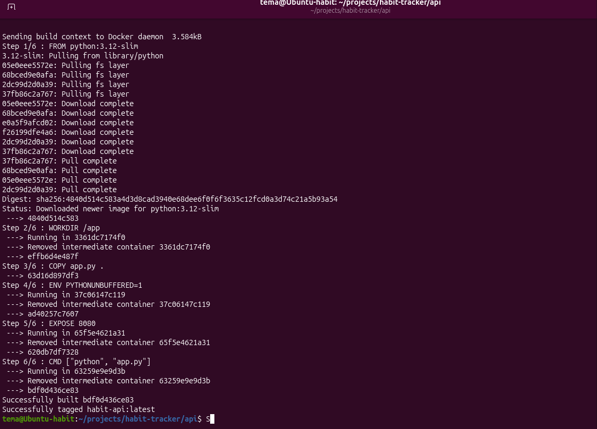
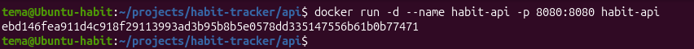
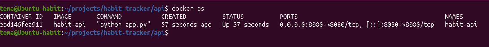
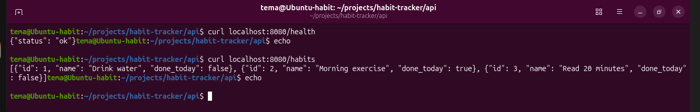
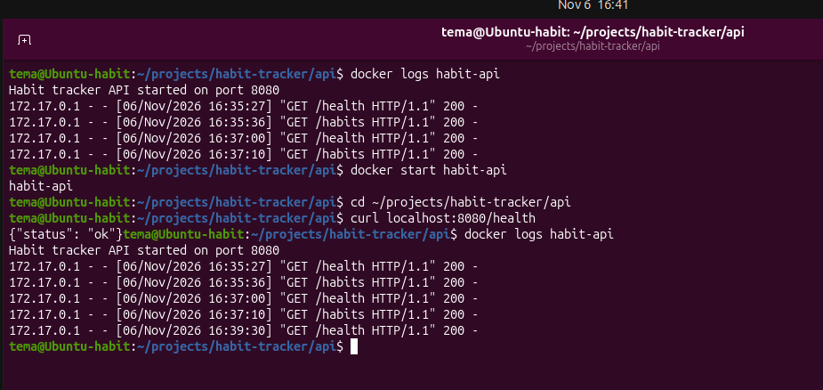

# Habit Tracker API (Docker)

Простое API для проектной темы **«Трекер привычек»**, запущенное в Docker-контейнере.
Написано на Python (стандартная библиотека, без внешних зависимостей).

## Endpoints

| Метод | Адрес | Что возвращает |
|---|---|---|
| GET | `/health` | `{"status": "ok"}`, проверка, что сервис работает |
| GET | `/habits` | список привычек (id, название, выполнена ли сегодня) |

Любой другой адрес возвращает `404`.

## Файлы

- `app.py` — исходный код API
- `Dockerfile` — инструкция сборки образа
- `README.md` — этот файл

## Запуск без Docker (локальная проверка)

```bash
python3 app.py &
curl localhost:8080/health
curl localhost:8080/habits
kill %1
```

## Dockerfile

| Инструкция | Зачем |
|---|---|
| `FROM python:3.12-slim` | базовый образ с Python |
| `WORKDIR /app` | рабочая папка внутри контейнера |
| `COPY app.py .` | копирует код приложения в образ |
| `ENV PYTHONUNBUFFERED=1` | вывод программы сразу попадает в логи |
| `EXPOSE 8080` | документирует порт приложения |
| `CMD ["python", "app.py"]` | команда запуска при старте контейнера |

## Сборка образа

```bash
docker build -t habit-api .
```



## Запуск контейнера

Порт 8080 контейнера пробрасывается на порт 8080 компьютера:

```bash
docker run -d --name habit-api -p 8080:8080 habit-api
```



## Проверка

Список запущенных контейнеров:

```bash
docker ps
```



Запросы к API:

```bash
curl localhost:8080/health
curl localhost:8080/habits
```



Логи контейнера:

```bash
docker logs habit-api
```



## Остановка и удаление

```bash
docker stop habit-api
docker rm habit-api
```
