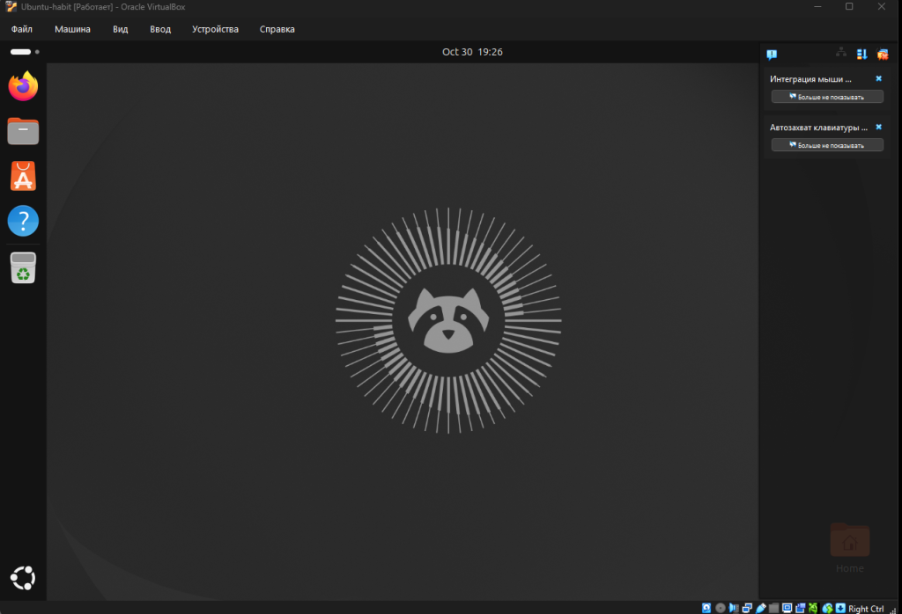
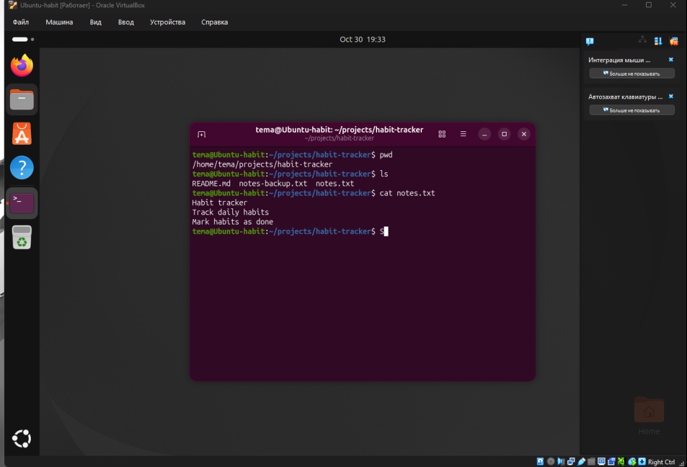
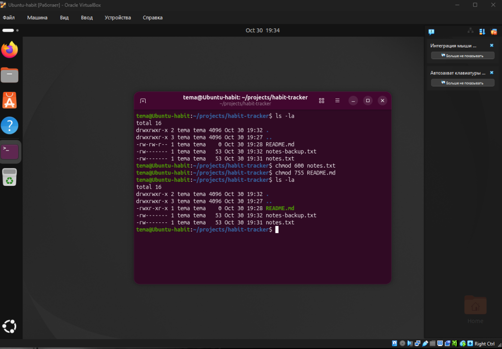
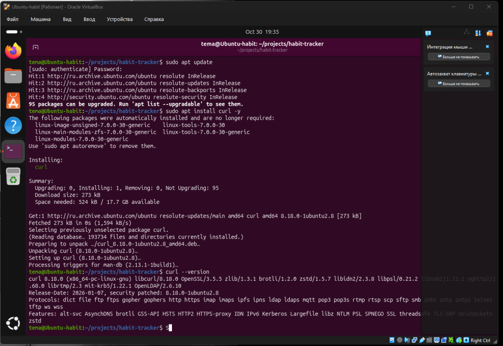
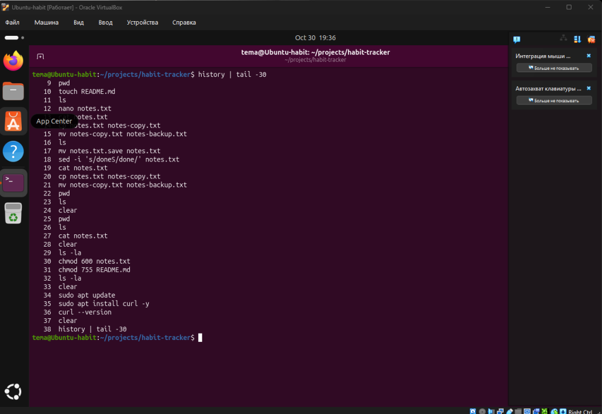

# Отчёт по практике: Linux

**Проектная тема:** трекер привычек (`habit-tracker`)

## 1. Окружение

- Виртуализация: Oracle VirtualBox
- ОС: Ubuntu 26.04.1 LTS
- Пользователь: `tema`
- Рабочая папка проекта: `/home/tema/projects/habit-tracker`

### Скриншот 1. Запущенная Ubuntu с открытым терминалом

## 2. Папки и файлы

Создана папка `projects`, внутри неё папка проекта `habit-tracker`. В ней созданы файл `README.md` (пустой, через `touch`) и текстовый файл `notes.txt` (три строки, через `nano`). Файл `notes.txt` скопирован в `notes-copy.txt`, а копия переименована в `notes-backup.txt`.

В процессе `nano` сохранил файл как `notes.txt.save`, поэтому он был переименован командой `mv` в `notes.txt`.

### Скриншот 2. Рабочая папка и файлы

## 3. Права доступа

Права просмотрены командой `ls -la`, затем изменены через `chmod`:

- `chmod 600 notes.txt` — владелец читает и пишет, остальным доступа нет (`-rw-------`)
- `chmod 755 README.md` — владелец читает, пишет и запускает, остальные читают и запускают (`-rwxr-xr-x`)

Права нужно менять, чтобы закрывать файлы от чужого доступа (например, личные заметки) и разрешать запуск тем файлам, которые должны выполняться.

### Скриншот 3. Права до и после `chmod`

## 4. Установка пакета через apt

Установлен пакет `curl`: сначала обновлён список пакетов (`sudo apt update`), затем выполнена установка (`sudo apt install curl -y`). Версия проверена командой `curl --version` (curl 8.18.0).

### Скриншот 4. Установка curl

## 5. История команд

### Скриншот 5. Вывод `history`

## 6. Список использованных команд

| Команда | Что делает |
|---|---|
| `pwd` | показывает текущую папку |
| `mkdir -p ~/projects/habit-tracker` | создаёт папку `projects` и папку проекта внутри |
| `cd ~/projects/habit-tracker` | переходит в папку проекта |
| `touch README.md` | создаёт пустой файл |
| `nano notes.txt` | открывает редактор, чтобы записать текст в файл |
| `cat notes.txt` | выводит содержимое файла |
| `cp notes.txt notes-copy.txt` | копирует файл |
| `mv notes-copy.txt notes-backup.txt` | переименовывает копию |
| `mv notes.txt.save notes.txt` | переименовывает файл, сохранённый nano под другим именем |
| `sed -i 's/doneS/done/' notes.txt` | исправляет лишнюю букву в тексте |
| `ls` | показывает список файлов |
| `ls -la` | показывает файлы с правами доступа и скрытые файлы |
| `chmod 600 notes.txt` | меняет права файла |
| `chmod 755 README.md` | меняет права файла |
| `sudo apt update` | обновляет список пакетов |
| `sudo apt install curl -y` | устанавливает пакет curl |
| `curl --version` | проверяет версию curl |
| `history` | показывает историю выполненных команд |
| `clear` | очищает экран терминала |
